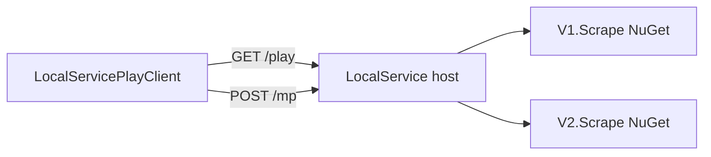

# Copilot Handoff — VardyParty Local Service

## What this project is

A self-hosted .NET 11 ASP.NET Core companion service that replaces the Cloudflare Worker’s
`GET /play/:url` endpoint. It runs on the same LAN as the client application, advertises itself
via mDNS and UDP broadcast, and resolves stream URLs from sports-streaming pages.

Repository: [Vardy-Party/local-service](https://github.com/Vardy-Party/local-service).

## Current state (as of September 2026)

### Solution structure

```text
M3U8-resolver/
  VardyParty.LocalService.slnx
  VardyParty.LocalService/              ASP.NET Core host (LAN discovery, /health, /play, /mp)
  VardyParty.LocalService.Client/       Discover + call the local service (NuGet)
  VardyParty.LocalService.Tests/        CI unit / WebApplicationFactory tests
  VardyParty.LocalService.TestClient/   Manual console probe
  docs/MP_CHROME.md                     V2/MP Chrome bring-up
  docs/MP_PROTOCOL.md                   POST /mp contract
```

V1/FB Playwright scrape and V2/MP system-Chrome scrape live in the separate **Strategies**
repository and are consumed as NuGet packages from GitHub Packages (`Vardy-Party`):

| Package | Role |
|---|---|
| `VardyParty.LocalService.Abstractions` | Shared models (`MpPlayRequest` / `MpPlayResult`) and plugin contracts |
| `VardyParty.LocalService.V1` / `.V1.Scrape` | V1/FB strategy + Playwright scrape plugin |
| `VardyParty.LocalService.V2` / `.V2.Scrape` | V2/MP strategy + system Chrome scrape plugin |
| `VardyParty.LocalService.Client` | LAN discovery + `/play` / `/mp` client (published from this repo) |



### Important host files

| File | Purpose |
|---|---|
| `VardyParty.LocalService/Program.cs` | DI, CORS, Playwright first-run install, `/health`, `/play`, `/mp` |
| `VardyParty.LocalService/ScrapePluginResolver.cs` | Typed plugin resolution by `StrategyId` |
| `VardyParty.LocalService/Discovery/*` | UDP / mDNS / firewall helpers |
| `VardyParty.LocalService/appsettings.json` | Playwright + Chrome options + Auth0 placeholders |
| `VardyParty.LocalService/Auth/` | Auth0 JWT + stream-viewer policy for `/play` and `/mp` |

### Package restore

`NuGet.config` uses `nuget.org` and `github-vardy-party` (GitHub Packages). CI authenticates with
repo secrets **`NUGET_GITHUB_TOKEN`** (`read:packages` PAT) and **`NUGET_GITHUB_USERNAME`**
(owner of that PAT). Workflows write credentials into `NuGet.config` at runtime so `<clear />`
does not drop auth. `GITHUB_TOKEN` alone usually 403s for packages published from **Strategies**.

Do **not** commit a hard-coded sibling path such as `../Strategies/artifacts/nuget`. For local
Strategies packs, add a user-level source:

```powershell
dotnet nuget add source "C:\path\to\Strategies\artifacts\nuget" --name strategies-local
```

## Endpoints

| Method | Path | Strategy |
|---|---|---|
| `GET` | `/health` | Anonymous — `{ status, version, capabilities }` — `version` is the LocalService package semver |
| `GET` | `/play/{*url}?stream=` | Auth0 Bearer required — V1/FB via Playwright (`V1ScrapePlugin`) |
| `POST` | `/mp` | Auth0 Bearer required — V2/MP via installed Chrome (`V2ScrapePlugin`) |

Error responses for unhandled execution failures return a stable `{ "error": "..." }` object only.
Exception type/message stay in server logs.

`ASPNETCORE_ENVIRONMENT=Testing` (or `Testing:SkipLanHost=true`) skips LAN bind, discovery,
scrape plugin registration, and browser install so `WebApplicationFactory` tests can run in CI.

## Client routing

`LocalServicePlayClient.ResolveAsync` chooses `/play` vs `/mp` from catalog
`resolutionStrategy` / `source` and advertised capabilities (`mp.chrome`). When it uses `/mp`,
`PlayResult` preserves `RewrittenSegments` and `Streams` from `MpPlayResult`.

Prefer explicit `ResolveMpAsync` when you need the full MP payload (browser info, script URLs, etc.).

## How to run locally

```powershell
dotnet restore VardyParty.LocalService.slnx
dotnet build VardyParty.LocalService.slnx
dotnet run --project VardyParty.LocalService/VardyParty.LocalService.csproj
dotnet test VardyParty.LocalService.Tests/VardyParty.LocalService.Tests.csproj
```

See [DEVELOPMENT.md](./DEVELOPMENT.md), [docs/MP_CHROME.md](./docs/MP_CHROME.md), and
[docs/MP_PROTOCOL.md](./docs/MP_PROTOCOL.md).

## Discovery protocol

### mDNS

Advertises `_vardy-party-api._tcp.local`.

### UDP broadcast fallback

Client sends:

```json
{"type":"vardy-party-discovery","version":1}
```

Service replies with HTTP port and instance id (see `DiscoveryProtocol` in the Client package).
