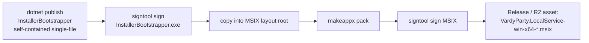

Installer Bootstrapper — Overview

What the InstallerBootstrapper does
- Provides a signed, elevated installer EXE that installs the packaged MSIX and performs privileged system changes the MSIX cannot run itself.
- Calls Add-AppxPackage to install the MSIX and then creates explicit, narrow Windows Firewall rules (UDP and TCP port ranges) required for LAN discovery and HTTP access.
- Exposes an uninstall flow (can be invoked by the bootstrapper) that removes the MSIX package and cleans up any firewall rules the bootstrapper created.

How it is built and shipped
- The bootstrapper is published **self-contained, single-file, trimmed** for win-x64 (`InstallerBootstrapper.csproj`). The output is one compressed `InstallerBootstrapper.exe` that needs no .NET runtime on the target machine, the same as the self-contained LocalService payload. Only that one EXE is copied anywhere, so it must not depend on sibling files.
- It ships **inside the MSIX**, at the package root next to `AppxManifest.xml`. It is **not** a separate GitHub Release or R2 asset. CI (`main-packaging.yml`) and `scripts/build-local-release.ps1` both publish it, sign it with the MSIX certificate, copy it into the MSIX layout and then run `makeappx`, so the embedded copy is signed. `scripts/build-and-install-msix.ps1` publishes and signs it after packing and runs it straight from the layout folder to install the MSIX it just built, with elevation and the firewall rules.

How it affects the MSIX
- The MSIX itself is a signed, distributable package. MSIX install creates a package identity and the OS may add an app-scoped firewall rule automatically; that rule is typically application-scoped and not port-specific.
- The bootstrapper is built from the same source and signed with the same certificate; when run it performs Add-AppxPackage (or trusts the publisher cert) and then removes any preexisting VardyParty firewall rules and creates explicit port-based rules using New-NetFirewallRule/netsh. Embedding it in the MSIX keeps the installer and payload versions matched, but the OS will not execute embedded EXEs automatically during MSIX install.

Firewall rule lifecycle
- OS app-scoped rule: when the MSIX is installed Windows may create an application-bound firewall rule tied to the package identity. This rule is removed automatically when the package is uninstalled. It is often non-port-specific (allows Any/Any).
- Explicit installer rules: the bootstrapper and/or the packaged service can create explicit firewall rules (LocalPort set to a specific port or port range). Those rules persist until explicitly removed.
- Service-managed rules: the packaged service (when running as LocalSystem) can create/remove explicit rules on start/stop. This is useful to ensure runtime correctness, but may run before the OS applies its app-scoped rule; installer bootstrapper is used to guarantee deterministic state immediately after install.

Why we need the bootstrapper (what it solves)
- Privileged steps: MSIX cannot run arbitrary elevated code at install time. The bootstrapper runs elevated and can perform tasks requiring system privileges (import certs, set system firewall rules, run Add-AppxPackage reliably).
- Deterministic install: ensures the exact firewall rules (UDP discovery range and TCP HTTP range) are created and any OS-created app-scoped rules are removed or replaced so remote clients discover the service reliably.
- Uninstall cleanup and UX: exposes a single signed EXE users can run to install and fully uninstall the service and its explicit firewall rules. Avoids asking users to manually import certs or run PowerShell commands.

What we lose if we remove the bootstrapper
- Without a bootstrapper, MSIX-only installs will often rely on OS-created app-scoped firewall rules which are non-port-specific and may not satisfy client discovery behavior (clients may not discover the service reliably).
- Users will need to perform extra manual steps (trust certificate, call Add-AppxPackage, run firewall commands) or rely solely on the service to create rules at runtime (which can be subject to timing/order issues and service account restrictions).

Recommendations
- Keep the bootstrapper a signed, self-contained single EXE built from the same source as the MSIX, so the installer always matches the packaged payload. If it ever becomes a separate user-facing download, upload the signed EXE from `artifacts/bootstrapper/win-x64` as its own release asset rather than relying on the copy inside the MSIX.
- Keep service runtime rule management as a fallback (service Start/Stop should create/remove explicit rules) for resilience.
- Document install/uninstall steps and provide the bootstrapper artifact as the primary download for Windows users.

See also
- README.md — top-level project overview and install notes
- scripts/build-local-release.ps1, scripts/create-msix-only.ps1 and scripts/build-and-install-msix.ps1 — local packaging and installer generation scripts
- packaging/windows/InstallerBootstrapper/Program.cs — bootstrapper implementation
- packaging/windows/VardyParty.LocalService.Package/Package.appxmanifest — MSIX manifest and capabilities
